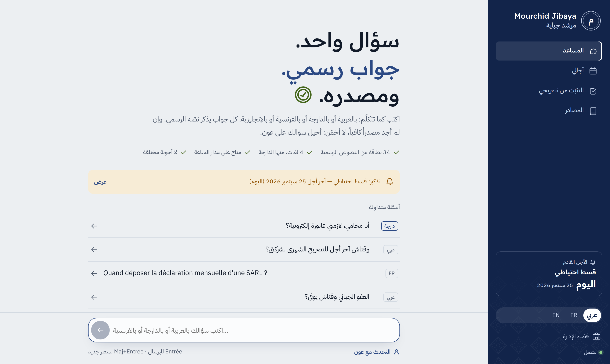
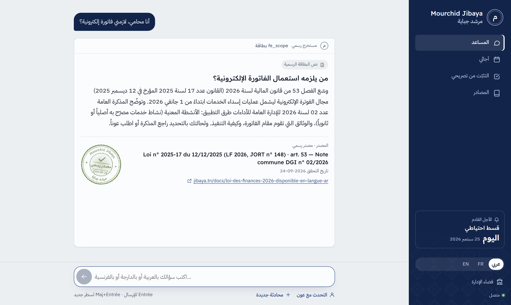
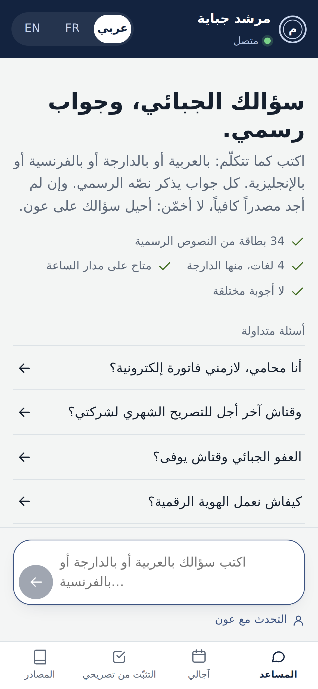
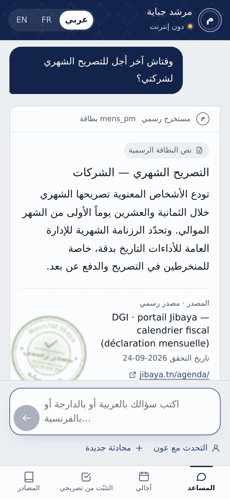

<div dir="rtl">

# مرشد جباية

النسخة الفرنسية: [README.md](README.md)

**مساعد جبائي ذكي على مدار الساعة، بالعربية والدارجة التونسية والفرنسية والإنجليزية، يجيب من النصوص الرسمية فقط ويذكر كل مرجع.** إن لم يجد مصدراً كافياً لا يخمّن: يحيل السؤال على عون المصلحة المختصة، ومعه سياق المحاولة.

## ما هو مرشد جباية، ولمن هو؟

مرشد جباية نموذج أولي لمساعد جبائي تونسي. وُضع للمطالب بالأداء، من أصحاب المؤسسات الصغيرة جداً والمهن الحرة ومن الأشخاص الطبيعيين، حين يحتاج إلى أجل أو إجراء أو نص دون التنقّل بين المجلات والمذكرات العامة والمنصّات. يكتب سؤاله كما يتكلّم، فيأتي الجواب بلغته، مع مرجع النص الرسمي ورابطه وتاريخ التحقق منه وحالة البطاقة: «مصدر رسمي» أو «للتأكيد».

وهو أيضاً أداة للمصلحة الجبائية: إن لم تبلغ النتيجة عتبة الثقة لم يُختلق جواب، وأُحيل السؤال على العون المختص. ويعرض فضاء الإدارة المؤشرات وصفّ الإحالات ومصادقة الخبير على البطاقات.

## السياق

قُدّم المشروع في الهاكاثون الوطني «IA & Finances Publiques» (الذكاء الاصطناعي والمالية العمومية) يومي 25 و26 سبتمبر 2026. نظّمته المدرسة الوطنية للديوانة (École Nationale des Douanes) والمدرسة الوطنية للمالية (École Nationale des Finances) بمعية مدرسة إسبري للأعمال (Esprit School of Business)، تحت إشراف وزارة المالية التونسية.

التحدّي الرئيسي للمشروع هو T9: روبوت محادثة ومساعد افتراضي على مدار الساعة. والتحدّي المكمّل هو T4: التيسير على المطالبين بالأداء.

## المزايا

ما يلي هو ما يفعله النموذج في هذا المستودع:

- **مساعد يستشهد بمصادره.** سؤال حر بالعربية أو بالدارجة أو بالفرنسية أو بالإنجليزية، وجواب بلغة المستعمل، مع مرجع النص الرسمي ورابطه وتاريخ التحقق وحالة الاعتماد («مصدر رسمي» أو «للتأكيد»).
- **إجابة قابلة للتفسير.** كل جواب يبيّن كيف وُجد: اللغة المكتشفة، والكلمات المعتمدة، والمفاهيم المتعرّف إليها في اللغات كلّها، والبطاقات المرشّحة، والنقاط، وعتبات الثقة.
- **لا اختلاق.** تحت عتبة الثقة يقول المساعد «لا أعرف»، ويعرض أقرب البطاقات، ويحيل على عون.
- **ضوابط ضد الغش.** الطلب الصريح للمساعدة على الغش يُقابل برفض معلّل وبمسالك قانونية (عفو 2026، والنظام التقديري، والخطايا، والاتصال بالإدارة العامة للأداءات). والسؤال الملتبس، مثل «دون فاتورة» أو «أدفع أقل»، يُقابل بتذكير بالإطار القانوني.
- **إحالة على العون المختص** في الإعلام الجبائي، أو المراقبة، أو القباضة، أو السجل الوطني للمؤسسات، أو الهوية الرقمية. يتلقّى العون السؤال واللغة وما حاوله المساعد.
- **آجالي.** رزنامة حسب وضعية المطالب بالأداء، مع تأجيل آلي إذا وافق الأجل يوم أحد أو يوم عطلة، وتذكير قبل 7 أيام ويومين وفي يوم الأجل، يُضاف إلى رزنامة الهاتف (ملف `.ics`).
- **التثبّت من تصريحي.** إعادة احتساب الأداء الشهري على القيمة المضافة ومراقبة الأجل، على مبالغ يُدخلها المستعمل بنفسه. لا يُرسَل شيء، ولا نفاذ إلى منظومات الإدارة.
- **فضاء الإدارة** على المسار `/admin`. مؤشرات مباشرة، منها نسبة الحل دون عون مع صيغة حسابها، والمواضيع، واللغات، والإحالات؛ ومحاكي للربح؛ وصفّ الإحالات؛ ومصادقة الخبير على البطاقات؛ واختبار المحرّك.
- **إن انقطع الخادم** تتحوّل الواجهة من تلقاء نفسها إلى محرّك يعمل داخل المتصفح. وتوجد أيضاً نسخة من ملف واحد تُفتح على الهاتف دون إنترنت.

تعتمد الأجوبة على 34 بطاقة مبنية على نصوص عمومية: قانون المالية لسنة 2026، ومجلات الأداء (الضريبة على الدخل وعلى الشركات، والأداء على القيمة المضافة، والحقوق والإجراءات الجبائية، والجباية المحلية)، ومذكرات عامة للإدارة العامة للأداءات، والقانون عدد 52 لسنة 2018 المتعلق بالسجل الوطني للمؤسسات، والأمر عدد 54 لسنة 2019، وبوابات jibaya.tn والسجل الوطني وTunTrust. منها 20 بطاقة في حالة «مصدر رسمي»، و13 «للتأكيد»، وبطاقة واحدة داخلية.

مبدأ العمل هو «البحث أولاً، ثم الصياغة تحت قيد»: البحث يختار البطاقة الرسمية، ونموذج اللغة لا يفعل سوى إعادة صياغتها بلغة المستعمل وبحسب وضعيته، دون أن يضيف إليها شيئاً. فإن لم تكفِ البطاقة أجاب بـ `NO_SOURCE`. وعند غياب مفتاح النموذج أو تعطّله تُعرض البطاقة الرسمية كما هي، ويمكن دائماً عرض النص الأصلي.

## لقطات من الواجهة العربية

الصفحة الرئيسية بالعربية على الحاسوب:



جواب يستشهد بالنص الرسمي، على الحاسوب:



الصفحة الرئيسية والجواب على الهاتف:




## التشغيل

**عبر الإنترنت:** افتح عنوان العرض [https://cyrineg-mourchid-jibaya.hf.space](https://cyrineg-mourchid-jibaya.hf.space). الإدارة على `/admin`، وتوثيق الواجهة البرمجية على `/docs`.

**دون اتصال:** ملف واحد يُفتح على الهاتف دون إنترنت: [`dist/Mourchid_Jibaya_hors_ligne.html`](dist/Mourchid_Jibaya_hors_ligne.html).

**على الجهاز** (Python 3.10 فما فوق):

<div dir="ltr">

```bash
pip install -r requirements.txt
python serveur.py            # http://localhost:8000 · /admin · /docs
```

</div>

أو انقر نقراً مزدوجاً على `lancer_windows.bat` (ويندوز) أو شغّل `./lancer_mac_linux.sh` (ماك ولينكس). يُنشئ أول تشغيل بيئة العمل ويثبّت المتطلبات.

لصياغة الأجوبة بنموذج اللغة، عيّن `ANTHROPIC_API_KEY` (متغير بيئة أو ملف `config.env`، انظر `config.env.exemple`).

**Docker:**

<div dir="ltr">

```bash
docker build -t mourchid-jibaya . && docker run -p 7860:7860 -e ANTHROPIC_API_KEY=... -e CODE_ADMIN=... mourchid-jibaya
```

</div>

**Hugging Face Spaces:**

<div dir="ltr">

```bash
HF_TOKEN=... ANTHROPIC_API_KEY=... CODE_ADMIN=... python outils/deployer_hf.py <compte>/mourchid-jibaya
```

</div>

## وثائق بالعربية

- العرض التقديمي: [docs/Pitch_Mourchid_Jibaya_AR.pdf](docs/Pitch_Mourchid_Jibaya_AR.pdf) · [docs/Pitch_Mourchid_Jibaya_AR.pptx](docs/Pitch_Mourchid_Jibaya_AR.pptx)
- المذكرة التأليفية: [docs/Note_de_synthese_Mourchid_Jibaya_AR.pdf](docs/Note_de_synthese_Mourchid_Jibaya_AR.pdf)

## الفريق

- **سماح قسومة** (Sameh Gassouma, GitHub [@samehgassouma-cloud](https://github.com/samehgassouma-cloud)) — صاحبة الفكرة وقائدة الفريق: جمعت كل المحتوى الجبائي، بنت واجهة HTML ومكوّنات التطبيق، وحدّدت هدفه.
- **سيرين قسومة** (Cyrine Gassouma, GitHub [@CyrineGASSOUMA](https://github.com/CyrineGASSOUMA)) — مهندسة البرمجيات.

المستودع الأصلي: [https://github.com/CyrineGASSOUMA/mourchid-jibaya](https://github.com/CyrineGASSOUMA/mourchid-jibaya)

## حدود هذا النموذج

- 13 بطاقة ما تزال «للتأكيد» على النص الرسمي، والقاعدة تنتظر مصادقة الإدارة العامة للأداءات.
- التغطية محدودة بمواضيع البطاقات، وما عداها يُحال على عون.
- تواريخ الأعياد الدينية تقديرية، والمبلغ الدقيق للخطايا غير محتسب.
- في هذا العرض يُصفَّر السجل (الإحالات والعدّادات) عند إعادة تشغيل الخادم.

</div>
