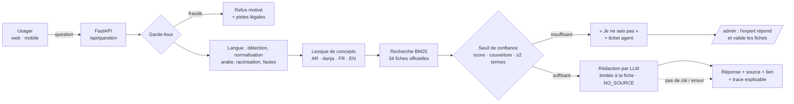

🇹🇳 النسخة العربية: [README.ar.md](README.ar.md)

# Mourchid Jibaya · مرشد جباية

**Assistant fiscal IA 24h/24, en arabe, darija, français et anglais, qui répond uniquement à partir des textes officiels et cite chaque référence.** Sans source suffisante, il ne devine pas : il transmet la question à l'agent du service compétent, avec tout le contexte.

| | |
|---|---|
| Hackathon | National IA & Finances publiques — 25-26 septembre 2026 (END · ENF · Esprit) |
| Défi principal | **T9** — Chatbot / agent virtuel IA 24h/24 (axe 2) |
| Défi complémentaire | **T4** — Facilitation pour les contribuables |
| Équipe | Sameh Gassouma (conseillère fiscale depuis 2007, profil métier) · Cyrine Gassouma (ingénieure logiciel, profil technique) |
| Démo en ligne | https://cyrineg-mourchid-jibaya.hf.space · administration : `/admin` · API documentée : `/docs` |
| Démo hors ligne | [`dist/Mourchid_Jibaya_hors_ligne.html`](dist/Mourchid_Jibaya_hors_ligne.html) : un fichier, s'ouvre sur téléphone sans Internet |

## Travaux préparatoires (déclaration, art. 6.1 du cahier des charges)

Avant le hackathon, l'équipe avait réalisé une recherche documentaire sur les sources fiscales officielles et une maquette
exploratoire. **Le code de ce dépôt a été entièrement écrit pendant le hackathon** (à partir du 25/09/2026, 17h00) ;
l'historique Git horodaté en fait foi. Les faits et textes des fiches proviennent de la base documentaire préparatoire (déclarée),
convertie au nouveau format ; questions types, lexique, validation experte et tout le code sont réalisés pendant le hackathon.

## Ce que fait le prototype

- **Assistant cité (T9)** : question libre en AR / darija / FR / EN → réponse dans la langue de l'usager, avec la référence du texte officiel, le lien, la date de vérification et l'état de validation (« source officielle » ou « à confirmer »).
- **IA explicable** : chaque réponse affiche *comment elle a été trouvée* — langue détectée, mots retenus, concepts reconnus dans toutes les langues, fiches candidates, score et seuils de confiance.
- **Zéro invention** : sous le seuil de confiance, « je ne sais pas » + fiches proches + transfert à un agent.
- **Garde-fous anti-fraude** : demande explicite de fraude → refus motivé et pistes légales (amnistie 2026, régime forfaitaire, pénalités, contact DGI) ; question ambiguë (« sans facture », « payer moins ») → rappel du cadre légal.
- **Transfert à l'agent** du service compétent (information fiscale, contrôle, recette, RNE, identité numérique) : l'agent reçoit la question, la langue et ce que l'assistant a tenté.
- **Mes échéances (T4)** : calendrier selon le profil, report automatique des dimanches et jours fériés, rappels J-7 / J-2 / jour J dans l'agenda du téléphone (.ics).
- **Vérifier ma déclaration (T4)** : recalcul de la TVA mensuelle et contrôle du délai, sur des montants saisis (rien n'est transmis).
- **Espace administration** : indicateurs en direct (taux de résolution sans agent avec sa formule, sujets, langues, transferts), simulateur de gain, file des tickets, validation experte des fiches, test du moteur.
- **Résilience** : si le serveur ne répond plus, l'interface bascule automatiquement sur le moteur embarqué dans le navigateur.

## Architecture



**Principe « rechercher d'abord, rédiger sous contrainte » (RAG)** : la recherche choisit la fiche officielle ; le modèle de langage ne fait que la reformuler dans la langue et la situation de l'usager, sans rien ajouter. Il répond `NO_SOURCE` si la fiche ne suffit pas ; en cas d'absence de clé ou de panne, la fiche officielle est affichée telle quelle. L'usager peut toujours afficher le texte officiel d'origine.

| Dossier / fichier | Rôle |
|---|---|
| `app/main.py`, `app/routes/` | API FastAPI (usager, pilotage, administration), documentation OpenAPI sur `/docs` |
| `app/schemas.py` | validation des entrées (Pydantic) |
| `mourchid/langue.py`, `lexique.py` + `data/lexique.json` | détection de langue, normalisation de l'arabe, racinisation, concepts multilingues |
| `mourchid/recherche.py` | index BM25 pondéré par champ, seuils de confiance |
| `mourchid/assistant.py` | orchestration : garde-fous → recherche → seuil → réponse citée + explication |
| `mourchid/modele.py` | rédaction contrainte par LLM (API Claude ou Ollama local), repli sur la fiche |
| `mourchid/gardefous.py` | refus des demandes d'aide à la fraude, vigilance |
| `mourchid/echeances.py`, `rappels.py`, `verification.py` | calendrier fiscal, fichiers .ics, pré-contrôle TVA |
| `mourchid/base.py`, `journal.py` + `data/fiches.json` | fiches officielles et validation experte, journal SQLite (comptages) |
| `web/` | interface usager (`index.html`, `assets/app.js`) et administration (`admin.html`, `assets/admin.js`), sans framework |
| `web/moteur.js` | moteur en JavaScript (portage du moteur Python) pour le mode hors ligne |
| `outils/` | construction hors ligne, parité Python/JS, recette navigateur (Playwright), déploiement Hugging Face |

## Démarrer

**En ligne** : ouvrir l'URL de démonstration ci-dessus.

**En local** (Python 3.10+) :

```bash
pip install -r requirements.txt
python serveur.py            # http://localhost:8000 · /admin · /docs
```

Ou double-clic sur `lancer_windows.bat` / `./lancer_mac_linux.sh` (crée l'environnement au premier lancement).
Rédaction par IA : définir `ANTHROPIC_API_KEY` (variable d'environnement ou `config.env`, voir `config.env.exemple`).

**Docker** : `docker build -t mourchid-jibaya . && docker run -p 7860:7860 -e ANTHROPIC_API_KEY=... -e CODE_ADMIN=... mourchid-jibaya`

**Hugging Face Spaces** : `HF_TOKEN=... ANTHROPIC_API_KEY=... CODE_ADMIN=... python outils/deployer_hf.py <compte>/mourchid-jibaya`

## Résultats mesurés

| Mesure | Résultat |
|---|---|
| Jeu indépendant : 25 formulations nouvelles (FR, AR/darija, EN) — `python tests/evaluation.py` | **25/25** bonnes fiches, source citée |
| Questions hors sujet | **4/4** transférées à un agent, aucune invention |
| Tests automatisés (moteur, API, garde-fous, échéances, TVA, sécurité admin) — `python -m unittest discover -s tests` | **24/24** |
| Parité moteur Python / moteur JavaScript hors ligne — `python outils/verifier_parite.py` | **101/101** questions identiques ; échéances, TVA et .ics identiques |
| Temps de réponse de la recherche (sans LLM) | < 1 ms par question |
| Base de fiches | 34 : 20 « source officielle », 13 « à confirmer », 1 interne |

| Recette navigateur de bout en bout (usager desktop et mobile arabe, hors ligne, repli automatique, administration) — `python outils/recette_e2e.py` | **28/28**, aucune erreur JavaScript |

Intégration continue : `.github/workflows/ci.yml` rejoue tests, évaluation, parité et construction Docker à chaque push.

## Données

- Textes officiels publics et licites : loi de finances 2026, codes fiscaux (IRPP/IS, TVA, CDPF, fiscalité locale), notes communes DGI, loi n° 2018-52 (RNE), décret n° 2019-54 ; portails jibaya.tn, RNE et TunTrust.
- Données simulées : montants saisis dans « Vérifier ma déclaration ». Aucune donnée personnelle ou confidentielle ; aucun accès aux systèmes de l'administration. Le tableau de pilotage ne contient que des comptages.

## Bibliothèques, modèles et outils tiers (déclaration, art. 4.1)

- Python 3 ; **FastAPI** et **Uvicorn** (serveur web) ; bibliothèque standard pour le moteur (`sqlite3`, `json`, `unicodedata`, `re`, `math`).
- Interface HTML / CSS / JavaScript sans framework ; polices **IBM Plex Sans Arabic** et **Readex Pro** (Google Fonts).
- Modèle de langage pré-entraîné, utilisé uniquement pour reformuler une fiche retrouvée : **Claude Haiku 4.5 (API Anthropic)** ; alternative souveraine : modèle local via **Ollama** (ex. Qwen 2.5). Aucun modèle entraîné par l'équipe.
- Hébergement de la démonstration : Hugging Face Spaces (Docker).
- Développement assisté par IA : Claude (Anthropic).

## Limites

- 13 fiches restent « à confirmer » sur le texte officiel ; la base doit être validée par la DGI.
- Couverture limitée aux sujets des fiches ; les autres questions sont transférées à un agent.
- Dates des fêtes religieuses estimées ; montant exact des pénalités non calculé.
- Démo : le journal (tickets, compteurs) est réinitialisé au redémarrage du serveur.

## Recommandations pour une mise en production

Cellule DGI de validation des fiches ; hébergement en Tunisie avec modèle local (souveraineté, loi organique n° 2004-63, déclaration INPDP) ; pilote de 3 mois dans un centre des impôts avec groupe témoin ; intégration Jibayti / El Fatoora et canaux WhatsApp et voix.

## Équipe

- **Sameh Gassouma** (سماح قسومة, GitHub [@samehgassouma-cloud](https://github.com/samehgassouma-cloud)) — porteuse de l'idée et cheffe d'équipe : elle a rassemblé tout le contenu fiscal, construit l'interface HTML et les composants de l'application, et défini son objectif.
- **Cyrine Gassouma** (سيرين قسومة, GitHub [@CyrineGASSOUMA](https://github.com/CyrineGASSOUMA)) — ingénieure logiciel.

Dépôt d'origine : https://github.com/CyrineGASSOUMA/mourchid-jibaya
